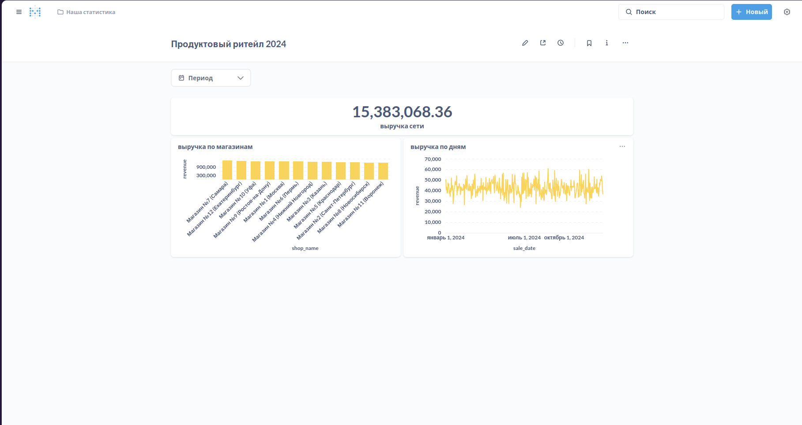

# P10. Дашборд Metabase

Источник данных: ClickHouse, база `olap` (таблицы из P07 и сводка `sales_by_shop_day` из P09). Файл DuckDB дашборд не читает.

## Подключение

1. Скачать драйвер `clickhouse.metabase-driver.jar` версии **1.52.x** (под Metabase v0.52.16 из `P01/docker-compose.yml`): <https://github.com/ClickHouse/metabase-clickhouse-driver/releases>.
2. Положить его в `P01/metabase/plugins/` и перезапустить Metabase: `docker compose restart metabase`.
3. В Metabase: **Admin → Databases → Add database → ClickHouse**:
   - Host: `clickhouse` (имя сервиса в docker compose);
   - Port: `8123`;
   - Database: `olap`;
   - Username: `default`, пароль пустой.

## Дашборд «Продуктовый ритейл 2024»

| № | Виджет | Тип | SQL | Таблица | Вопрос |
|---|--------|-----|-----|---------|--------|
| 1 | Выручка сети | карточка (число) | `dashboards/widget1_revenue.sql` | `fact_receipt_line` | главная метрика из `P04/sql/canonical_metric.sql` |
| 2 | Выручка по дням | линия | `dashboards/widget2_daily.sql` | `sales_by_shop_day` | как выручка меняется в течение года |
| 3 | Выручка по магазинам | столбцы | `dashboards/widget3_shops.sql` | `sales_by_shop_day` | какой магазин продаёт больше (вопрос «где?» из паспорта) |

Все три виджета — вопросы на SQL (Native query), текст запросов лежит в `dashboards/`.  
Карточка 1 считает эталон по детальной таблице, графики 2–3 читают сводку из P09 — суммы у них одинаковые (сверка в `P09/notes/z09.md`).

## Фильтр «Период»

В каждом запросе есть переменная `{{period}}` типа **Field Filter**:

| Виджет | Поле фильтра |
|--------|--------------|
| 1 | `fact_receipt_line.sold_at` |
| 2, 3 | `sales_by_shop_day.sale_date` |

Тип виджета переменной — «Date Filter», переменная необязательная: пока фильтр пуст, условие `[[AND {{period}}]]` не подставляется и виджеты показывают весь 2024 год.  
На дашборде один фильтр «Период» (тип «Дата → Все варианты»), привязан к `period` во всех трёх карточках.

## Скриншот

